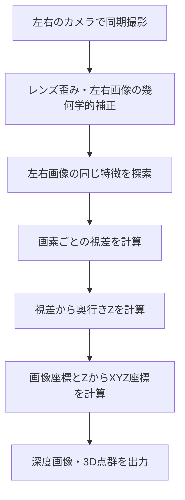
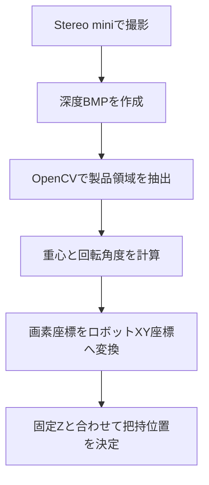

# Basler Stereo miniの3次元計測原理

対象機種：**Basler Stereo mini STM-502u**  
目的：ステレオカメラが深度画像・XYZ点群を作る仕組みを理解する

## 1. まず結論

Stereo miniは、左右に離して配置した2つのカメラで同じ対象を撮影し、**同じ場所が左右の画像のどこに写るか**を比較して奥行きを計算するカメラです。この方法を**ステレオビジョン（三角測量）**と呼びます。

- **基線長（Baseline）**：左右カメラの光学中心間の距離
- **視差（Disparity）**：同じ対象点が左右画像でずれて見える量
- **深度（Depth）**：カメラから対象点までの奥行き方向の距離
- **点群（Point Cloud）**：多数の点のXYZ座標を集めたデータ

STM-502uの基線長は**50 mm**です（ユーザー提供の製品仕様表）。

## 2. 人間の両目と同じ考え方

顔の前に指を立てて、左目だけ・右目だけで交互に見ると、背景に対する指の位置がずれて見えます。指を顔に近づけるほど、ずれは大きくなります。

ステレオカメラも同様です。

- **近い対象物**：左右画像の位置のずれが大きい
- **遠い対象物**：左右画像の位置のずれが小さい

このずれを数値化したものが「視差」です。

## 3. 基線長とは何か

```text
       左カメラ                 右カメラ
          ●----------------------●
          |<--- 基線長 B ------->|
           \                    /
            \                  /
             \                /
              \              /
                 ● 対象点
```

基線長Bは、**カメラ筐体の幅ではなく、左右の撮像系の基準となる光学中心の間隔**です。

同じ焦点距離・同じ撮影距離・同じ視差検出精度なら、基線長が長いほど視差が大きくなり、遠方の奥行き変化を区別しやすくなります。ただし、近距離で両方のカメラに写る範囲や、遮蔽物の影響などには不利になる場合があります。

STM-502uのBは50 mm、STM-952uなど95 mm系モデルは95 mmです。これは製品設計上の違いであり、**基線長だけで製品の精度が決まるわけではありません**。

## 4. 視差とは何か

左右カメラは少し違う位置から同じ対象物を見ています。そのため、同じ模様や角が、左右の画像で異なる横位置に写ります。

```text
左画像：   ..........★................
右画像：   ......★....................
                 ↑
      横方向の位置の差 = 視差 d
```

画像を幾何学的に整列（**レクティフィケーション／平行化**）した場合、対応点はほぼ同じ画像行に並ぶため、主に横方向のずれを調べればよくなります。

例えば、左画像のx=400 px、右画像のx=300 pxなら、視差は100 pxです（ここでは単純化した例）。

**大事な点：** 単に左右の画像全体をずらすのではなく、**左右で同じ物理的な点を探す**必要があります。これを「ステレオマッチング」と呼びます。

## 5. なぜ視差から距離が計算できるのか

左右カメラの配置と、レンズの焦点距離が既知だからです。三角形の相似関係から奥行きを求められます。

理想的な平行ステレオカメラでは、次の式で表せます。

$$
Z = \frac{f B}{d}
$$

| 記号 | 意味 | 単位の例 |
|---|---|---|
| $Z$ | 奥行き方向の距離 | mm |
| $f$ | 焦点距離（画像上の画素単位） | pixel |
| $B$ | 基線長 | mm |
| $d$ | 視差 | pixel |

**計算例（理解用の仮定値）**：基線長B=50 mm、焦点距離f=800 pixelと仮定します。これはSTM-502uの実際の校正値を示すものではありません。

| 視差 d | 計算した奥行き Z |
|---:|---:|
| 200 pixel | 200 mm |
| 100 pixel | 400 mm |
| 50 pixel | 800 mm |
| 20 pixel | 2,000 mm |

視差が半分になると、奥行きは2倍になります。逆に言うと、**遠くなるほど視差が小さくなり、わずかな視差誤差が大きな距離誤差になりやすい**ということです。

実機ではレンズ歪みや左右の位置・角度のずれを校正したうえで処理します。上の式は原理を理解するための簡略式です。

## 6. 左右画像から3D点群ができるまで



### 6.1 同期撮影

左右カメラが同じタイミングで撮影します。撮影タイミングがずれると、動く対象物の位置が変化して視差計算に誤差が生じます。

### 6.2 画像補正

実際のレンズには歪みがあり、左右カメラも完全な理想配置ではありません。校正情報を使って、対応点を探しやすい画像へ補正します。

### 6.3 ステレオマッチング

左画像のある画素付近の模様とよく似た部分を、右画像から探します。単一画素の明るさだけでなく、周辺の模様や連続性などを使うのが一般的です。**Stereo mini内部のアルゴリズムの細部は公開資料だけでは断定できません。**

### 6.4 深度計算

求めた視差をカメラの校正値と組み合わせ、各画素のZを計算します。十分な対応関係が見つからない場所は、無効値になることがあります。

### 6.5 XYZ座標への変換

カメラの内部パラメータ（焦点距離や画像中心位置）を用いて、奥行きZから横方向X・縦方向Yも計算できます。単純化したピンホールモデルでは、

$$
X = \frac{(u-c_x)Z}{f_x}, \qquad
Y = \frac{(v-c_y)Z}{f_y}
$$

ここで$(u,v)$は画像の画素座標、$(c_x,c_y)$は画像中心に相当する主点、$(f_x,f_y)$は画素単位の焦点距離です。座標軸の向き・原点はカメラの定義に従います。

**深度画像の1画素と、点群のXYZの1点が対応する**ため、画像処理で見つけた位置と3D座標を関連付けられます。

## 7. STM-502uの赤外線パターン投影

ステレオマッチングでは、左右画像の中で同じ場所を見つけるための**模様（テクスチャ）**が重要です。

例えば、真っ白な平面では、どこも似た明るさなので対応点を探しにくくなります。そこで、STM-502uのような**アクティブステレオモデル**は、赤外線のパターンを対象物へ投影し、画像に人工的な模様を加えることで対応点を見つけやすくします。

```text
        赤外線投光器
             ↓  点状などのパターン
       ・  ・  ・  ・  ・
      ┌────────────────┐
      │  模様の少ない面  │
      └────────────────┘
        ↑            ↑
     左カメラ       右カメラ
```

### ToF方式との違い

赤外線を使うからといって、光の往復時間を測る**ToF（Time of Flight）方式**とは限りません。STM-502uの基本原理は、あくまで**左右画像の視差による三角測量**です。投光器は、主に対応点を探しやすくする役割です。

### パッシブステレオとの違い

- **パッシブステレオ**：対象物に元々ある模様・明暗を使う
- **アクティブステレオ**：投影した模様も利用できる

投光すれば必ず測れるわけではありません。強い外光、反射、材質、撮影距離などで結果は変わります。

## 8. 測定できない点・ノイズが発生する理由

| 現象 | 原因の例 |
|---|---|
| 平坦な無地の面に穴が開く | 左右で対応点を特定しにくい |
| 物体の縁が欠ける | 片方のカメラから見えない領域がある（遮蔽） |
| 光沢面・金属面が乱れる | 反射によって左右画像の見え方が変わる |
| 黒い対象が欠ける | 受光量・コントラストが不足する場合がある |
| 遠距離でZがばらつく | 視差が小さくなり、視差誤差の影響が大きい |
| 測定範囲外で不安定 | 製品が想定する撮影距離・条件から外れる |

**「画像に写っている」ことと「有効な3D座標が得られる」ことは別**です。

## 9. 深度精度と距離の関係

理想式$Z=fB/d$を微分すると、視差の小さな誤差$\Delta d$による奥行き誤差の大きさは、おおよそ次のようになります。

$$
|\Delta Z| \approx \frac{Z^2}{fB}|\Delta d|
$$

つまり、ほかの条件が同じなら**距離Zが2倍になると、同じ視差誤差に起因する奥行き誤差は約4倍**になり得ます。

これは理論的な傾向であり、実際の製品精度をこの式だけで予測することはできません。撮影条件、校正、処理方式、表面状態なども影響します。

ユーザー提供の仕様表ではSTM-501u/502uについて、**撮影範囲0.26～3 m、2 m時の深度精度≦1.5%**と記載されています。例えば2 mの1.5%は30 mmですが、**この数値をそのまま全距離・全画素の誤差保証として扱わない**ことが重要です。測定条件や「精度」の定義を公式資料で確認してください。

## 10. 現在のPythonプログラムとのつながり

現在のプログラムは、左右画像から視差を自作計算しているわけではありません。**Stereo mini内部で生成された3D座標をpypylon経由で取得**しています。

```python
camera.ComponentSelector.Value = "Range"

if camera.PixelFormat.Value != "Coord3D_ABC32f":
    raise RuntimeError("PixelFormatがCoord3D_ABC32fではありません。")
```

`Coord3D_ABC32f`は、各点のX・Y・Zを32bit浮動小数点として扱う形式です。

```python
xyz = data.reshape(height, width, 3).copy()
```

この結果、概念的には次の配列が得られます。

```text
xyz[v, u, 0] → X座標
xyz[v, u, 1] → Y座標
xyz[v, u, 2] → Z座標
```

### PLYとBMPの違い

- **PLY**：有効なXYZ座標を保存する3D点群ファイル
- **BMP**：Z座標を0～255の濃淡へ変換した2D画像

BMPは目視やOpenCVでの領域検出に便利ですが、**8bit化するとZの細かい数値情報は失われます**。正確な3D位置が必要なら、元のXYZ配列を使います。

また、現在の`DEPTH_MIN=180`、`DEPTH_MAX=300`は**プログラム側の保存対象フィルター**です。製品の公称撮影範囲（下限260 mm）を広げる設定ではありません。260 mm未満の結果は仕様保証外として慎重に扱ってください。

## 11. ロボットピッキングへの応用

対象物が同じ平面上にあり、Z高さを固定して扱える場合は、次の構成が考えられます。



ただし、**画像のXY画素座標とロボットのXY座標は別物**です。カメラの設置位置・角度・作業面を使って座標変換を校正する必要があります。

また、固定Zで運用する場合も、実際の製品高さ、把持位置、衝突防止、設備側の安全インターロックは別途確認が必要です。

## 12. 理解しておきたい重要ポイント

1. Stereo miniは**左右画像の視差**から3Dを求める。
2. 基線長は**左右カメラの光学中心間距離**。STM-502uは50 mm。
3. **近いほど視差が大きく、遠いほど視差が小さい**。
4. 基本式は$Z=fB/d$。距離が遠いほど視差誤差の影響を受けやすい。
5. STM-502uの赤外線投光は、**模様の少ない対象の対応点検出を助ける**。
6. 測定不能点はあり得る。光沢、遮蔽、無地の面、距離などに注意。
7. 現在のPythonコードは**カメラ内部で計算されたXYZ**を取得している。
8. **8bit BMPは表示・検出用**、精密なXYZ利用には元の3Dデータを使う。

## 参考資料

以下のうち、**STM-502u固有の仕様値**はユーザー提供の仕様表を基にしています。数式や一般的なステレオ幾何は説明用の理論であり、内部実装の詳細を示すものではありません。

- [Basler Stereo mini 製品紹介（日本語）](https://www.baslerweb.com/ja-jp/cameras/basler-stereo-camera/stereo-mini/)
- [Basler Stereo mini 公式ドキュメント](https://docs.baslerweb.com/basler-stereo-mini)
- [Basler Stereo mini Features](https://ja.docs.baslerweb.com/stereo-mini-features)
- [Basler C++ Programmer's Guide：深度データへのアクセス](https://ja.docs.baslerweb.com/cpp-prog-guide-%28stereo-mini%29)
- [Basler Performance：深度品質の評価](https://ja.docs.baslerweb.com/performance)
- [NVIDIA Isaac ROS：Stereo Depth（一般原理）](https://nvidia-isaac-ros.github.io/v/release-2.1/concepts/stereo_depth/index.html)

---

作成日：2026-11-11
